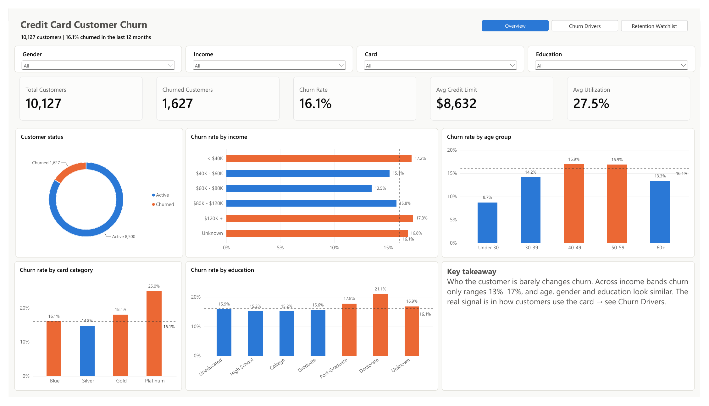
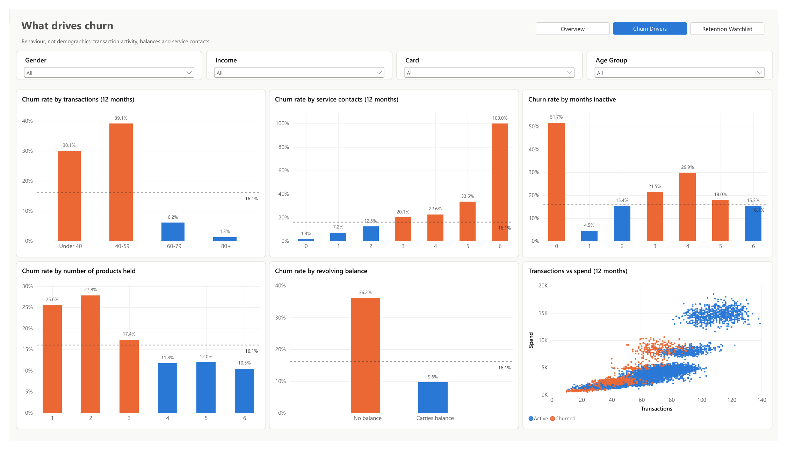
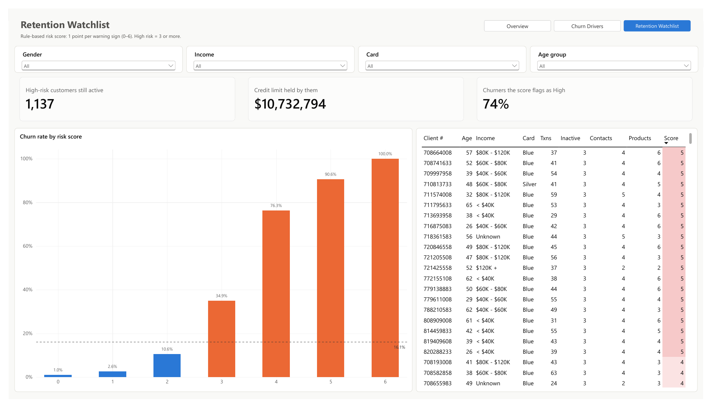

# Credit Card Customer Churn: Power BI Dashboard

**Business question:** A bank is losing credit-card customers. Who is leaving, why, and which current customers should the retention team contact first?

**Tools:** Power BI Desktop · Power Query (M) · DAX · rule-based risk scoring
**Data:** [Credit Card Customers](https://www.kaggle.com/datasets/sakshigoyal7/credit-card-customers): 10,127 customers, 21 attributes, 16.1% churned

📄 **[View the full dashboard as PDF](BankChurn.pdf)** · 📊 Open `BankChurn.pbix` in Power BI Desktop to interact with it

## Key findings

| # | Finding | Evidence |
|---|---|---|
| 1 | **Demographics barely move churn** | Income bands range only 13.5%–17.3%. Age, gender and education are similar |
| 2 | **Low card activity is the strongest signal** | <60 transactions/yr: ~35% churn. 60+: ~4% |
| 3 | **Customers with no revolving balance leave** | 36.1% churn vs 9.6% for those carrying a balance (3.8x) |
| 4 | **Repeated service contacts precede churn** | 1.8% at 0 contacts, rising to 33.5% at 5 contacts |
| 5 | **Fewer products = weaker relationship** | 1–2 products: ~27% churn. 4+ products: ~11% |

## Retention watchlist

A transparent **6-rule risk score** (1 point each: <60 transactions, Q4/Q1 activity drop <0.6, no revolving balance, 4+ contacts, ≤2 products, 3+ inactive months):

- Churn climbs from **1% at score 0 to 76% at score 4** and **100% at score 6**
- "High risk" (score ≥3) captures **74% of all past churners**
- It flags **1,137 customers who are still active**, holding **$10.7M in credit limits**: a ready-made call list

## Recommendations

1. Trigger outreach when a customer's transaction count drops quarter-over-quarter, before inactivity sets in.
2. Treat a 3rd+ service contact in 12 months as an escalation, not a routine ticket.
3. Cross-sell a second or third product to 1–2 product customers. Relationship depth is protective.
4. Revisit the score monthly. A predictive model (e.g. gradient boosting) should be benchmarked against this rule-based baseline.

## How it's built

| Layer | What | File |
|---|---|---|
| Power Query | Typing (locale-safe), labels, sort keys, age/transaction bins, 6 risk flags, score and tier | `powerquery/Customers.m` |
| DAX | Churn rate, baseline via `ALLSELECTED`, variance-to-baseline for conditional colour, risk KPIs, dynamic subtitle | `dax/Measures.dax` |
| Report | 3 pages, synced slicers, page navigator, rule-based conditional formatting, dynamic average lines | `BankChurn.pbix` |
| Theme | Custom colour-blind-checked palette | `theme/churn-theme.json` |

**Limitations:** The data is a single snapshot (no dates), so trends over time can't be shown. The risk rules were derived and evaluated on the same data and would need validation on new periods.

---
Built by [Shazzad Sakim Sourav](https://www.linkedin.com/in/shazzadsourav/) · [Portfolio](https://shazzad-sourav.github.io)
